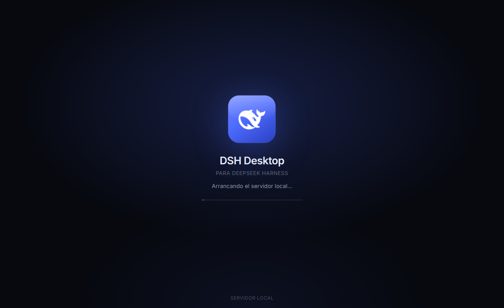

# DSH Desktop (Linux)

**Shell de escritorio no oficial para [DeepSeek Harness](https://github.com/deepseek-ai/deepseek-harness).**

Ventana nativa de Electron alrededor de `dsh web`: sin navegador, sin pestañas,
con icono propio, bandeja del sistema e integración de escritorio. Reutiliza el
`dsh` que ya tienes instalado por npm, así que tus sesiones, MCPs, skills y
credenciales siguen en `~/.dsh` tal cual.

> Sin afiliación con DeepSeek. Ver [NOTICE](NOTICE.md).



## Por qué

La app Desktop oficial se empaqueta solo para macOS y Windows. Este proyecto
cubre el hueco en Linux envolviendo el perfil Web que el CLI ya ofrece, sin
compilar el monorepo y sin tocar tu configuración existente.

## Funciones

- **Ventana nativa** con icono propio, sin barra de direcciones.
- **Servidor propio por ejecución**: lanza `dsh web --no-open --port 0`, lee la
  URL autenticada y la carga; al salir mata el grupo entero (servidor y MCPs).
- **Bandeja**: cerrar oculta y mantiene la sesión caliente; reapertura
  instantánea. Menú con abrir, nueva sesión, reiniciar servidor, logs y salir.
- **Integración**: entrada `.desktop`, iconos hicolor, comando `dsh-desktop` y
  arranque con la sesión opcional.
- **Actualizaciones**: consulta `@deepseek-ai/dsh` en npm (manual o diaria
  silenciosa), instala con npm y reinicia el servidor.
- **Consciente del sandbox**: usa el de Chromium cuando el sistema lo permite y
  cae a `--no-sandbox` en Ubuntu 24.04+ cuando AppArmor bloquea los namespaces
  de usuario.

## Requisitos

- Linux (X11 o Wayland; desarrollado en Ubuntu 26.04 + KDE Plasma 6 Wayland)
- Node.js 20+ y npm
- `dsh` instalado: `npm i -g @deepseek-ai/dsh`

## Instalación

```bash
git clone https://github.com/<tu-usuario>/dsh-linux-desktop.git
cd dsh-linux-desktop
./install.sh
```

Instala en `~/.local/share/dsh-linux-desktop`, descarga Electron (~275 MB) la
primera vez y registra el lanzador, los iconos y las entradas de escritorio.

Instalar en el propio repo (cómodo si vas a modificarlo):

```bash
DSH_DESKTOP_INSTALL_DIR=$PWD ./install.sh
```

Desinstalar:

```bash
./uninstall.sh        # conserva ~/.dsh y el estado de la app
```

## Uso

- Menú de aplicaciones → **DSH Desktop**
- Icono del escritorio → **DSH Desktop**
- Terminal → `dsh-desktop`

Cerrar la ventana la oculta en la bandeja. Para salir de verdad, **Salir** en el
menú del icono. Desmarca *«Cerrar la ventana la oculta»* para volver al
comportamiento clásico.

## Actualizaciones

- **Manual**: *Ayuda → Buscar actualizaciones…* (o el mismo ítem en la bandeja).
- **Automática**: una comprobación silenciosa cada 12 h, avisa una vez por
  versión y nunca instala sola. Se desactiva en *Ayuda → Comprobar al iniciar*.

Actualizar ejecuta `npm install -g @deepseek-ai/dsh@latest` con el npm dueño del
`dsh` detectado y reinicia el servidor local. El envoltorio no se autoactualiza:
`git pull` y `npm install` si cambiaron dependencias.

## Cómo funciona

1. Resuelve `dsh` (`DSH_BIN`, `~/.local/bin`, nvm, `PATH`).
2. Lanza `dsh web --no-open --port 0` en su propio grupo de procesos.
3. Lee del stdout la línea `dsh web: http://127.0.0.1:PUERTO/?token=…`.
4. Carga esa URL en la ventana; un splash cubre el arranque.
5. Al salir manda `SIGTERM` al grupo y `SIGKILL` a los 4 s.

## Variables

| Variable | Efecto |
|---|---|
| `DSH_BIN` | Ruta explícita al binario `dsh` |
| `DSH_DESKTOP_INSTALL_DIR` | Destino de `install.sh` |
| `DSH_DESKTOP_SANDBOX=1` | Fuerza el sandbox de Chromium |
| `DSH_DESKTOP_NO_SANDBOX=1` | Fuerza `--no-sandbox` |
| `DSH_DESKTOP_CAPTURE` | Captura la ventana a PNG y sale (pruebas) |
| `DSH_DESKTOP_CAPTURE_DELAY` | ms antes de capturar (6000 por defecto) |
| `DSH_DESKTOP_TEST_HIDE` | Prueba del cierre a la bandeja |
| `DSH_DESKTOP_TEST_UPDATE` | Prueba del comprobador de actualizaciones |

## Rutas

| Qué | Dónde |
|---|---|
| App | `~/.local/share/dsh-linux-desktop/` |
| Lanzador | `~/.local/bin/dsh-desktop` |
| Menú | `~/.local/share/applications/dsh-linux-desktop.desktop` |
| Iconos | `~/.local/share/icons/hicolor/*/apps/dsh-linux-desktop.*` |
| Estado, preferencias y logs | `~/.local/state/dsh-linux-desktop/` |
| Perfil de Chromium | `~/.config/dsh-linux-desktop/` |

## Diagnóstico

```bash
tail -f ~/.local/state/dsh-linux-desktop/logs/desktop.log
tail -f ~/.local/state/dsh-linux-desktop/logs/server.log
```

**No abre la ventana.** Ejecuta `dsh-desktop` en una terminal y mira stderr. En
sistemas que bloquean namespaces de usuario: `DSH_DESKTOP_NO_SANDBOX=1 dsh-desktop`.

**«No encuentro el ejecutable dsh».** Instálalo (`npm i -g @deepseek-ai/dsh`) o
define `DSH_BIN`.

## Licencia

MIT. Ver [LICENSE](LICENSE).
